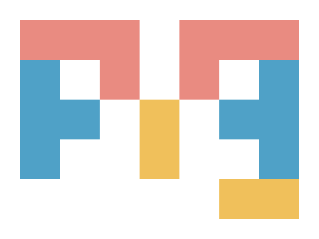

# pig

<p align="center">
  
</p>

> **Go 版 AI 编程助手 · pi 的行为级兼容重写**

[](https://go.dev/)
[](#license)
[](#provider实现--验证要分开看)
[](https://github.com/ZoroSpace/pig/actions/workflows/go.yml)
[](https://codecov.io/gh/ZoroSpace/pig)
[](https://goreportcard.com/report/github.com/ZoroSpace/pig)

pig 是 [pi coding agent](https://github.com/earendil-works/pi) 的 Go 实现——一个跑在终端里的 AI 编程智能体：读代码、改代码、跑命令、流式回复，会话可分支可回溯。pi 的 TypeScript 代码就是 pig 的规格书，provider 事件序列、CLI 参数、会话 JSONL 格式、TUI 按键手感逐项对齐。

> [!WARNING]
> pig 处于 dogfooding 阶段，CLI 与内部结构可能变化。真实服务仅验证了 DeepSeek、火山方舟 Coding Plan 与 Google（部分），其余 provider 请勿默认可用，详见[验证分层](#provider实现--验证要分开看)。

## 背景

项目始于一次学习：研究 pi agent 时，因不熟悉 TypeScript，但 pi 层次清晰、包分明，便把读到的逻辑逐段翻译成 Go，翻完理解顺畅许多，随即决定全部翻译、复刻一遍。

随后借助 pi 与 glm-5.3-flash 开发，10 天从零构建出 pig：底层会话存储格式、中层 agent 循环与工具执行、流式事件协议，到上层按键手感与交互体验，全部对齐 pi v0.84.3。自 2026-09-11（[b5ff964](https://github.com/ZoroSpace/pig/commit/b5ff964d1b6a70fbfca25220cff7812b6cdb751b)）起，用 pig 开发 pig，长期维护。pi 出一个新版本，就对齐一个版本，现已对齐至 v1.4.0。

## 快速开始

### 1. 构建

```bash
git clone https://github.com/ZoroSpace/pig.git && cd pig
scripts/build.sh
```

### 2. 启动并登录

```bash
./pig
```

进入交互式 TUI。输入 `/login` 选择 provider：API key 类粘贴 key 回车（凭证存入 `~/.pig/agent/auth.json`）；OAuth 类（Anthropic / Kimi / OpenAI Codex / xAI）走浏览器或设备码流程。

### 3. 开始对话

登录后 pig 自动选一个可用模型（想指定就用 `/model`），直接提问：

> 请快速浏览这个仓库，并告诉我最值得优先修复的问题

脚本与 CI 场景跳过交互，直接环境变量 + 参数：

```bash
DEEPSEEK_API_KEY=your-api-key \
  ./pig --provider deepseek --model deepseek-v4-flash -p "解释这个项目的整体结构"
```

完整环境变量见 `./pig --help`。

## 日常用法

### 交互模式

```bash
./pig
```

常用交互命令：

| 命令 | 作用 |
| --- | --- |
| `/model` `/thinking` | 选择模型、设置 thinking level |
| `/settings` | 修改运行设置 |
| `/tree` `/resume` `/fork` | 会话树导航、恢复历史会话、从任意消息分叉 |
| `/login` `/logout` | 管理 provider 认证 |
| `/trust` | 管理项目级信任 |
| `/compact` | 压缩当前会话上下文 |
| `/session` `/copy` | 查看会话统计、复制最后一条回复 |
| `/import` `/export` | 导入 JSONL 会话、导出 HTML（`.jsonl` 结尾则导出 JSONL） |
| `/new` `/reload` `/hotkeys` | 新会话、重载配置、查看快捷键 |

按 `Ctrl+P` 在已配置的模型之间快速切换。

### 脚本与 CI

```bash
./pig -p "列出所有 Go 文件，并分别概括它们的职责"
./pig --mode json -p "找出仓库中所有 TODO 注释"
git diff | ./pig -p "审查这个 diff，指出可能的正确性问题"
./pig @AGENTS.md "按仓库约定总结这个项目的提交规范"
./pig --export ~/.pig/agent/sessions/<项目>/<会话>.jsonl session.html   # 离线分享会话
```

支持管道输入与 `@文件` 引用；`--continue` / `--resume` / `--no-session` / `--session-dir` 等会话参数见 `./pig --help`。

### 从 pi 迁移

pig 与 pi 配置目录独立（`~/.pig/` vs `~/.pi/`），存量数据直接复制即可，会话 JSONL 双向兼容：

```bash
cp -a ~/.pi/agent ~/.pig/agent
```

## 特点

### 🔥 Pure Go：一个文件，开箱即跑

编译产物是**单个静态二进制**（38 MB），无 Node 依赖，拷到 Linux / macOS / Windows 即跑。与 pi（npm 安装，Node 运行时 + 依赖树）同机实测：磁盘 38 MB vs 436 MB + Node 115 MB、启动 0.025s vs ~1.0s、峰值内存 ~40 MB vs ~150 MB。

### 🔁 与 pi 无缝互通

- **会话记录双向兼容**：pig 写的 JSONL，pi 读得懂，反之亦然（用 pi v1.4.0 实测）；pi 的模型 catalog 逐字段零差异
- **配置隔离**：pig 用 `~/.pig/`、pi 用 `~/.pi/`，互不踩踏

### 🌐 41 家 provider，7 种 API 协议

各家接口格式互不相同（OpenAI、Anthropic、Gemini 长得完全不一样），pig 为每种接口格式移植独立适配器，事件语义（usage、tool call 边界、思考块、缓存命中、重试）逐协议对齐：openai-completions / openai-responses / azure-openai-responses / openai-codex-responses（含 WebSocket 与 zstd）/ anthropic-messages / google-generative-ai / google-vertex。内置约 1500 个模型开箱即用，非内置端点可用 `models.json` 自定义。

### 🛠 内置工具

`read` / `bash` / `powershell` / `edit` / `write` / `grep` / `find` / `ls`，带 diff 预览与文件互斥锁；`--tools` 支持 `+name`/`-name` 增删与 `*` 通配。项目级 `AGENTS.md` / `CLAUDE.md` 上下文文件、SKILL.md 技能、prompt 模板、项目信任机制全部就位。

### 🔌 MCP 内建客户端

pi 需要装社区扩展（pi-mcp-adapter）才有 MCP，pig 编译即得。配置复用生态标准 `mcpServers` JSON（Claude Code / Cursor 的 `.mcp.json` 直接可用），stdio 与 Streamable HTTP 都支持；上下文成本恒定（常驻只有一个代理工具，server 懒启动、空闲回收）；`/mcp` 面板可查看状态、重连、启停。

### ⌨️ pi-tui 全量移植的终端手感

差分行渲染器、编辑器引擎、补全系统一个不落：emacs 键位、流式 Markdown / LaTeX / Mermaid、会话树选择器、鼠标支持、OSC 7501 程序状态上报、主题系统。**对中文用户特别友好**：内置中文词典（gse），Ctrl+方向键按词跳转；修复了一整类 pi 上游的 CJK 渲染问题；内置火山引擎 Coding Plan provider。

### 🌳 会话树

会话天然支持分支：从任意历史节点重走、树形导航、自动压缩（上下文将满时自动总结裁剪）、自动重试（指数退避）。

### 🧪 工程质量

**23 万行 Go 源码 + 11 万行测试，2100+ 个测试函数，44 个包，`-race` 全绿**。pi 的大部分测试被 test-for-test 移植，每个修复都带回归测试；任何 goroutine panic 落盘到 `~/.pig/agent/logs/` 并尽力恢复。

### ✅ 已经做完

- **三种运行模式**：交互模式、print 模式、JSON 模式都已支持。
- **API 和模型服务商**：支持 7 种 API 协议、41 家 provider，并有模型目录（catalog）。
- **会话能力**：会话树、分支、压缩、导出 HTML 都已具备。
- **终端界面（TUI）**：已完整移植。
- **RPC 模式**：支持 `--mode rpc`。
- **图像处理**：用 Go 原生实现替代了 photon/WASM。
- **MCP**：已内置 MCP 客户端。

### ⏳ 暂不跟进

- **durable**：pi 把代号 Pico 的实验性 harness 抽取/迁移成了独立包 `packages/durable`。durable 这类包属于快速迭代的包，随时可能有 breaking change，等稳定后再迁移。
- **pi 的 experimental 代码**：比如远程编排等实验性架构，变化较快，且可能后续下掉，暂不跟进。
- **扩展系统（Node sidecar、包管理器）**：代码里已经预留了接入位置，设计存档在 [EXTENSION-PLAN](docs/handoffs/EXTENSION-PLAN.md)，暂不实施。

### ⛔ 明确不做

- **/bug 上报链路**：不单独做上报通道，pig 用户直接提 [issue](https://github.com/ZoroSpace/pig/issues)。
- **sqlite 会话后端 / client-server 栈**：上游已经删了，pig 不再跟进。

## Provider：实现 ≠ 验证

同一家 provider，「移植完成」「协议验证」「真实服务验证」是三个可信度层级：

| 状态 | 范围 |
| --- | --- |
| ✅ 真实端点已验证 | DeepSeek、火山方舟 Coding Plan、Google（部分） |
| 🔶 兼容端点已验证 | Anthropic Messages、OpenAI Responses 系（经 DeepSeek 兼容端点验证协议层） |
| 🧪 mock / 单测已验证 | 其余 provider、OAuth、provider 特有语义 |

完整边界与待验证条件见[真实服务验证矩阵](docs/handoffs/verify-matrix.md)。欢迎拿到其他家 key 的朋友帮忙实测——发现偏差请提 issue 或 PR，修复会按仓库惯例带回归测试合入。

## 项目结构

```
cmd/pig          CLI 装配入口
codingagent/     agent 运行时：会话管理、模型解析、设置、工具、交互模式
├─ core/         AgentSession、凭证、压缩、会话树、内置工具
├─ modes/        print / json / interactive 三种模式
agent/           agent 循环：steering/follow-up 队列、工具执行、生命周期
ai/              provider 层：7 种 API 协议适配器、模型 catalog、OAuth
tui/             pi-tui 移植：差分渲染器、编辑器引擎、组件库
```

## 开发

环境要求：Go 1.26+；跑真实请求时需要至少一个 provider 的凭证。

```bash
gofmt -w <改动文件>
go build ./cmd/pig
go vet ./...
go test ./... -timeout 120s                  # 单测（显式超时）
go test ./... -race -count=1 -timeout 600s   # 全量回归
```

约定：

- 全量 `-race` 回归**只跑一次**，需要通过包数或失败详情时复用同一次输出
- 连真实服务的测试需要真实凭证，默认不在普通测试中执行
- 重要修复与迁移决策记录到 `docs/fix/`、`docs/feat/`、`docs/handoffs/`，每起 fix 必须附带回归测试

## 贡献

欢迎提交 bug 修复和聚焦的改进。涉及行为变化时：

1. 添加或更新回归测试（修复需先以 stash 方式验证测试确实能抓到原 bug）
2. 先运行相关包的窄范围测试
3. 交付前运行全量 `-race` 测试
4. 修复与决策记录到 `docs/fix/`、`docs/feat/` 或 `docs/handoffs/`

## License

本项目基于 [pi](https://github.com/earendil-works/pi)（MIT）的行为规格重写，沿用 MIT License。
